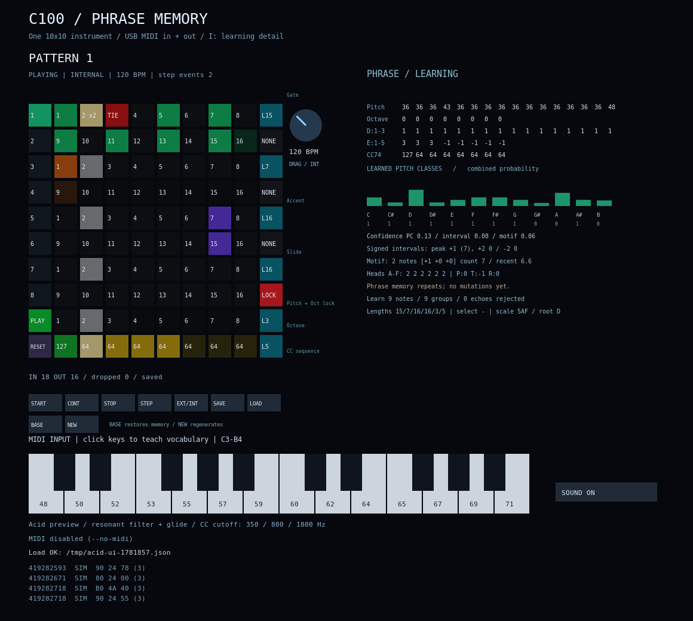

# C100 Phrase Memory

A generative acid and bassline sequencer for the **Keychron C100 8K 10×10 RGB
keypad**, with a Linux simulator you can play before flashing hardware.

Start with a repeating phrase, shape its rhythm, accent and slide, then let
selected pitches evolve. Freeze a groove, switch patterns, or teach the
generator new musical vocabulary through incoming MIDI—even while paused.
Each keypad is a complete, independent instrument.



## What it does

- Six independently sized lanes: Gate, Accent, Slide and Pitch Evolution have
  up to 16 steps; Octave and CC have up to 8.
- Persistent phrase memory with scale-constrained, seeded generation, tonal
  anchors, motif reuse and controlled mutation.
- Eight patterns sharing one global scale and tonal root.
- Live gate editing, eighth-note ties, velocity accents and MIDI legato overlap.
- Quantized transport, reset and pattern switching; internal clock or external
  MIDI Clock, Start, Stop and Continue.
- Statistical learning that blends recent and accumulated incoming notes with
  built-in bassline tendencies. Input changes future generation, not the
  current phrase immediately.
- RGB controls that work without a monitor, plus optional simulator diagnostics
  and a resonant acid-style audio preview.

Firmware runs the sequencer locally in QMK. USB supplies power and bidirectional
MIDI; a host routes MIDI to your synth. No second grid or simulator is required.

## Try the simulator

The simulator currently targets Linux. Install a C11 compiler, Make,
`pkg-config`, SDL2, Cairo, json-c, ALSA and Fontconfig development packages.
On Debian or Ubuntu:

```sh
sudo apt install build-essential pkg-config libsdl2-dev libcairo2-dev \
  libjson-c-dev libasound2-dev libfontconfig1-dev
```

Run these commands **from the repository root**, beside the `Makefile`:

```sh
make simulator
./.build/grid-simulator --demo --play
```

Click the grid to edit; hold a Gate for **450 ms** to make a two-step note.
The local sound includes a saw oscillator, resonant low-pass filter, accents
and legato glide. Press **I** for learning diagnostics and **Escape** to stop.
The onscreen piano feeds the learner.

For offline use:

```sh
./.build/grid-simulator --demo --play --no-midi --no-audio
```

The default local bank is `grid.json`; Save and Load are explicit. Local banks
are ignored by Git. See [build and MIDI routing](docs/build.md) for all options.

## Play the grid

Coordinates below describe the upright musical layout. Firmware can rotate
both key input and RGB output to suit the physical board orientation.

| Row | Left column | Eight middle keys | Right column |
| --- | --- | --- | --- |
| 0 | Pattern 1 | Gate 1–8 | Gate length |
| 1 | Pattern 2 | Gate 9–16 | Gate variation |
| 2 | Pattern 3 | Accent 1–8 | Accent length |
| 3 | Pattern 4 | Accent 9–16 | Accent variation |
| 4 | Pattern 5 | Slide 1–8 | Slide length |
| 5 | Pattern 6 | Slide 9–16 | Slide variation |
| 6 | Pattern 7 | Pitch Evolution 1–8 | Pitch Evolution length |
| 7 | Pattern 8 | Pitch Evolution 9–16 | Pitch/Octave Lock |
| 8 | Play/Pause | Octave 1–8 | Octave length |
| 9 | Reset / hold for Scale | CC 1–8 | CC length |

**Rhythm and ties.** Tap a Gate to toggle Off/green On. Hold for 450 ms to make
it yellow and sustain through the next position, shown red. Tap red to remove
the tie and restore that position's original value; tap yellow to turn its
source Off. Taps act on release. Accent and Slide toggle independently.

**Polymeter.** Press a lane's length button, then its desired last step. The
button flashes until selected. All lanes advance at sixteenth-note speed and
wrap at their own endpoints: Gate 15 and Accent 7 realign after 105 steps.

**Evolution.** Gate, Accent and Slide variation cycle None/Subtle/Moderate/Extreme
without overwriting the programmed steps. Pitch policies cycle
Inherit/Green/Yellow/Red: full, gentle or no mutation. Pitch Lock freezes both
pitch and octave memory; the CC lane keeps running.

**Scale and recovery.** Hold Reset for 450 ms to open the piano-style Scale page.
Tap piano notes to allow or disable them; hold a note to set the global root.
Tap Reset to exit. The page also provides Save, Load, clock selection, Restore
Base and Regenerate. Pattern changes wait for the next Gate wrap; Play/Pause
and short Reset presses wait for the next sixteenth.

The CC lane sends **0/red, 64/yellow or 127/green** every sixteenth, including
rests. It defaults to CC74. In the simulator these select base cutoff frequencies
of **350 Hz, 800 Hz and 1.8 kHz**, with an additional filter envelope and accent.

See the [complete control reference](docs/controls.md) for octave policies,
colors, inheritance and scale-page controls.

## Build firmware

Use the matching Keychron QMK source and ARM toolchain described in
[the build guide](docs/build.md#firmware-build). With QMK set up in a sibling
`qmk_firmware` checkout:

```sh
make firmware QMK_HOME=../qmk_firmware GRID_ROTATION=180 SEQUENCE_CC=74
```

The output is `keychron_c100_8k_grid_logic.bin`. Rotation supports
`0`, `90`, `180` and `270` degrees; this repository defaults to **180°**.
`SEQUENCE_CC` accepts controller numbers 0–127. Building does not flash.
See [hardware and flashing](docs/hardware.md) before installing on a C100 8K.

A C100 8K has been flashed and used successfully. Exhaustive hardware timing,
rollover and physical gesture validation remain ongoing. The local synth is an
acid preview, not a circuit-accurate TB-303 emulation; external glide depends on
the receiving synth's response to overlapping MIDI notes.

## Development

```sh
make check          # Core, gestures, storage, QMK adapter, simulator and audio
make test-sanitize  # AddressSanitizer and UndefinedBehaviorSanitizer
make test-usb QMK_HOME=../qmk_firmware  # Actual QMK build and USB descriptors
```

Live ALSA tests skip when no sequencer device is available. Automated checks do
not flash hardware. See [CONTRIBUTING.md](CONTRIBUTING.md) for the source map
and [validation](docs/validation.md) for coverage and limits.

## Documentation and license

[Controls](docs/controls.md) · [Musical algorithm](docs/semantics.md) ·
[Build and routing](docs/build.md) · [Architecture](docs/architecture.md) ·
[Hardware](docs/hardware.md) · [Validation](docs/validation.md)

Licensed under **GPL-2.0-or-later**; see [LICENSE](LICENSE) and
[third-party notices](THIRD_PARTY_NOTICES.md). The USB MIDI adaptations retain
their original attribution. QMK and Keychron firmware are external dependencies.
