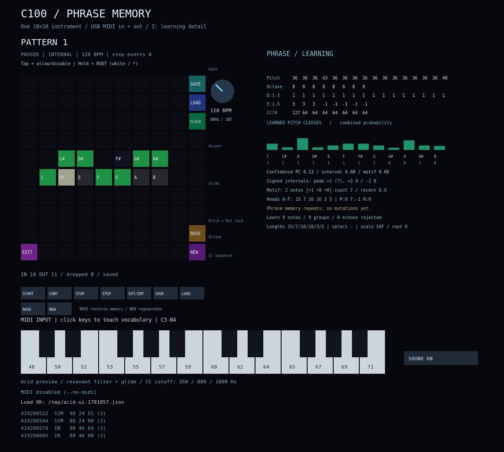

# Physical performance controls

All coordinates are zero based. C1–C8 are steps, C0 is the left control column,
and C9 is the right control column. All 80 step buttons remain available.

| Row | C1–C8 | C9 |
|---|---|---|
| R0 | Gate 1–8 | Gate length |
| R1 | Gate 9–16 | Gate evolution intensity |
| R2 | Accent 1–8 | Accent length |
| R3 | Accent 9–16 | Accent evolution intensity |
| R4 | Slide 1–8 | Slide length |
| R5 | Slide 9–16 | Slide evolution intensity |
| R6 | Pitch Evolution 1–8 | Pitch Evolution length |
| R7 | Pitch Evolution 9–16 | Combined Pitch/Octave Lock |
| R8 | Octave 1–8 | Octave length |
| R9 | CC 1–8 | CC length |

## Independent lengths

Press a lane's C9 length button. It flashes amber until you click the desired
last step **in that lane**. This sets its inclusive endpoint without editing
the step. For example, choose step 15 in Gate and step 7 in Accent. On the next
sixteenth-note visits, those lanes wrap independently at 15 and 7. Their
positions realign every LCM(15,7) = **105 steps**: a polymeter. Other lane lengths
can make the complete instrument's combined cycle longer, and evolution may
continue changing the musical content.

Re-press the armed length button to cancel; pressing another length button arms
that lane instead. Other lanes remain editable while one endpoint is armed.
Steps after the endpoint are dimmed and retained for future expansion. Shrinking
past the current playhead wraps to step one on the next sixteenth; it never
restarts other lanes or inserts an extra step. Every lane supports length one.
A–D have a maximum of 16; Octave and CC have a maximum of 8. Rates are fixed at
one sixteenth note per step (six MIDI clocks).

## Left column

C0/R0–7 select patterns 1–8. Current is green and pending is amber. Selecting
the current pattern cancels a pending switch. Switching waits for the Gate
lane's next wrap at its current length; while paused it uses a 96-clock
boundary. It releases the voice, resets all six playheads and retains the
previous pattern's editable/generated state. The global scale is unchanged.

C0/R8 is Play/Pause. Amber means queued, green playing and red paused. A second
press cancels the pending action. Physical transport applies at the next
sixteenth boundary. The internal oscillator continues while paused; external
operation requires incoming clocks.

C0/R9 is Reset. A short press queues reset only on release. Hold **450 ms** to
open Scale without resetting, then release. The page stays open. Tap Reset to
return without a reset. A normal reset returns all six playheads to their start
and releases the voice at the next sixteenth boundary; phrase and learning stay.
Entering Scale or resetting also cancels endpoint selection.

## Step values and evolution

**Tap a Gate to toggle Off/On (green); hold for 450 ms to make it two-step
On (yellow).** Taps act on release; holds become yellow at the threshold without
briefly disabling an existing green gate. Release after a hold does not toggle
again. Multiple Gate keys can be held independently.
Yellow holds one pitch for an eighth note, covering the following Gate position,
which appears **red** (`TIE` in the simulator). The red position does not trigger
a new note. Pressing red shortens its yellow source back to green and restores
the covered position's original value. Tapping yellow turns its source
Off and also reveals the original next step. This works across the active
Gate-length boundary. Length selection still consumes a step press without
editing its value.

Accent and Slide steps toggle off/on. All three intensity buttons cycle
**None → Subtle → Moderate → Extreme** (dim, green, yellow, red). None restores
the edited base lane immediately. Evolution uses a temporary performance layer;
it does not overwrite manually programmed steps. Active yellow/red pairs are
protected from Gate evolution. Playhead brightness preserves
the underlying hue.

D steps cycle **Off → Green → Yellow → Red**. Off inherits the last explicit
state within D's active length, wrapping cyclically. All Off means Green.
Green allows occasional full mutation, Yellow gentler changes, and Red no pitch
mutation. D's playhead selects policy; Gate's playhead selects the pitch-memory
position being mutated. Inactive steps do not contribute inherited policies.

C9/R7 toggles **combined Pitch/Octave Lock**. Red means locked. It freezes all
16 working pitch values and all 8 resolved octave values. Playheads continue
advancing and the CC lane continues emitting. Red D policies restrict pitch
mutation only; the combined lock is the way to freeze both memories.

E steps cycle **Off → Blue → Cyan → Yellow → Orange → Red**: inherit, +1,
+1/base, base, −1/base, −1. All Off means base. Inheritance wraps within E's
selected length. Random choices are retained in its 8-value working buffer and
freeze under the combined lock.

F/CC steps cycle **0/red → 64/yellow → 127/green**. There is no Off or inherited
CC state. Factory steps are yellow/64. Each sixteenth emits the current CC value
on the configured MIDI output channel, including when Gate is a rest. F has its
own independent length. The controller number is a build setting:
`SEQUENCE_CC`, default 74 (`ACID_SEQUENCE_CC` in the portable core). In the
simulator's local acid sound these states select base filter cutoff:
**red = 350 Hz, yellow = 800 Hz, green = 1.8 kHz**. A short filter envelope
and velocity accents open it further. External MIDI still sends 0/64/127.

## Global scale page

Tap a piano note to toggle whether it is allowed. **Hold a piano note for 450 ms
to set the tonal root for all eight patterns.** Holding also enables that note.
The root is white on hardware and marked `*` in the simulator. The gesture does
not regenerate or transpose the existing phrase; it guides future mutations and
NEW. If you disable the root, the nearest allowed note becomes the new root.

The piano uses white notes on R5 and black notes on R4:

```text
       C1 C2 C3 C4 C5 C6 C7
R4        C# D#    F# G# A#
R5     C  D  E  F  G  A  B
```

Green means allowed. Disabled whites are dim gray; disabled blacks dim blue.
The final allowed note cannot be disabled. Allowed pitch classes apply across
all octaves and **all eight patterns**, including hidden/locked pitch memory.
Changing the scale requantizes each pattern's base and working pitches to nearby
allowed notes and releases a sounding note. Switching patterns preserves this
instrument-wide scale.

| Coordinate | Action | Color |
|---|---|---|
| C9/R0 | Save all eight patterns and global scale; stop first | Teal |
| C9/R1 | Load saved bank; stop first | Blue |
| C9/R2 | Internal / external clock | Green / blue |
| C9/R8 | Restore base phrase/octaves and clear temporary lane variation | Amber |
| C9/R9 | Regenerate phrase using current vocabulary | Violet |
| C0/R9 | Return to performance | Violet |

Restore preserves lengths, intensities and the combined lock. Enabled evolution
can resume on later visits. Regenerate respects the lock. Base octave recovery
follows explicit octave policies, using base register for probabilistic policies.
Storage is explicit and stopped; the firmware never writes flash during playback.
A brief white C0/R0 notice means storage succeeded; dim means storage failed.


